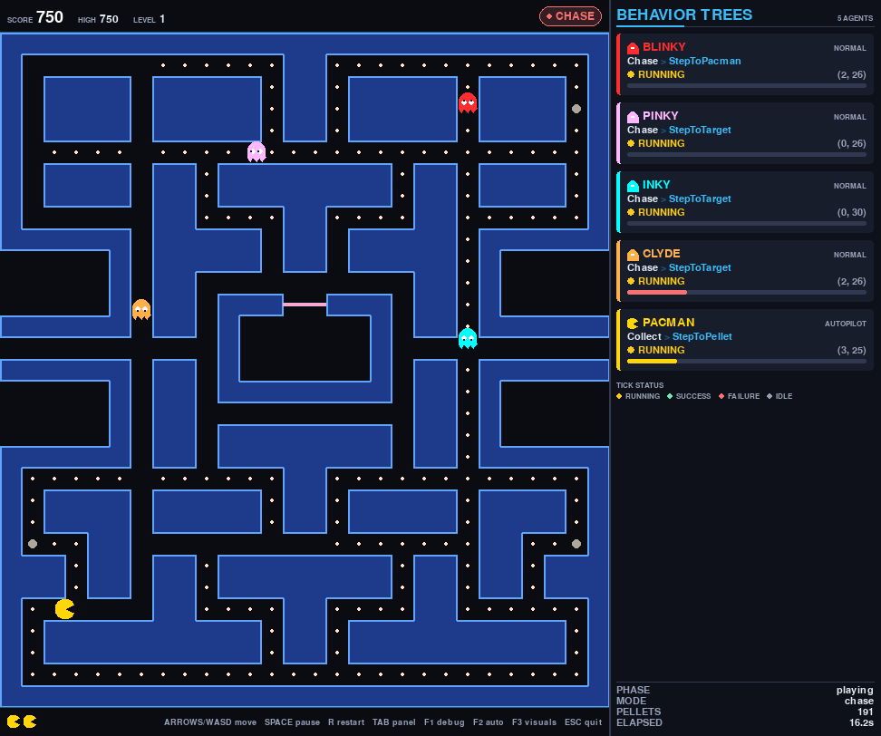
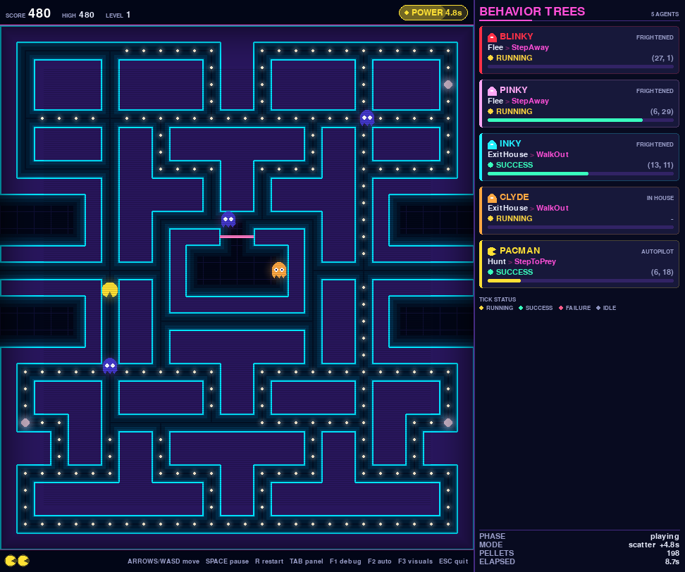
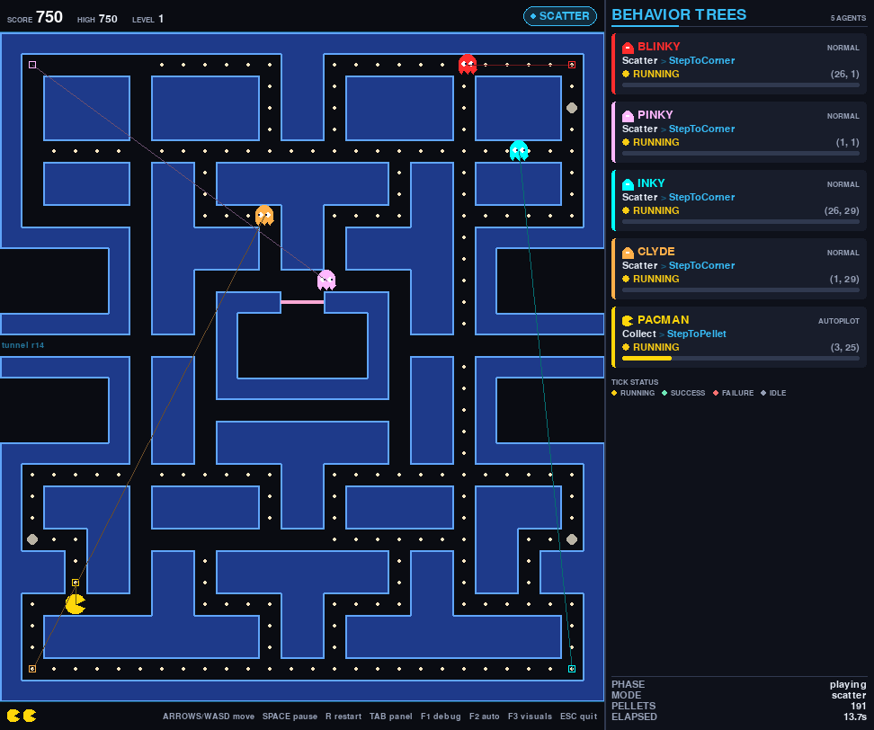
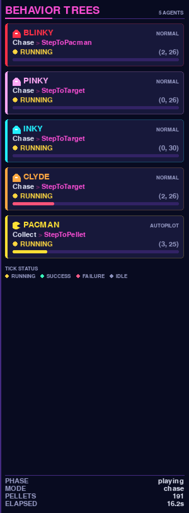

# Pac-Man x BTEng

The arcade Pac-Man, with **every ghost driven by its own [BTEng](https://pypi.org/project/bteng/)
behavior tree** loaded from XML — a pygame window on the left, a live view of
what the trees are thinking on the right, and BTEng's own `ZmqPublisher`
streaming every node transition on port **2667** so you can watch the same
trees tick in a second terminal.

No ROS 2, no Docker, no colcon, no Groot2. One virtualenv on the host, one
`python -m pacman_bteng`, and the whole thing runs.

| Agent | Driven by | Lives in |
|-------|-----------|----------|
| Blinky, Pinky, Inky, Clyde | one BTEng tree each | `bt_structures/ghost_*.xml` |
| Pac-Man (`--auto`) | a fifth tree, built on demand | `bt_structures/pacman_auto.xml` |
| Pac-Man (default) | your keyboard | `pacman_bteng/gui/input.py` |

Built on:

- 🌳 **BTEng** — the behavior-tree engine: <https://github.com/BTEng-dev/bteng> · <https://pypi.org/project/bteng/>
- 🎮 **pygame** — the window, the sprites and the keyboard.

```
./run.sh            # play it, arrow keys
./run.sh auto       # watch it play itself
```



The right-hand panel is the point of the project. Every ghost there is running
the *same* branch — `Chase` — through the *same* mover, and all four are walking
somewhere different, because the one node above the mover is different in each
of their four XML files.

📚 **Docs:** [docs/USAGE.md](docs/USAGE.md) — install, every flag, every config
key, the viewers, troubleshooting · [docs/ARCHITECTURE.md](docs/ARCHITECTURE.md) —
how it is built and what not to break · [docs/BEHAVIOR_TREES.md](docs/BEHAVIOR_TREES.md) —
the five trees and the full node catalogue · [CLAUDE.md](CLAUDE.md) — dev guide.

---

## Two visual presets

Both are the same game, drawn twice. `F3` switches between them mid-play, and
`--visuals` / `window.visuals` picks the one you start in.

| Preset | Looks like | Costs |
|--------|-----------|-------|
| **`lite`** (default) | Clean, crisp, high contrast: cobalt walls with a luminous edge, warm-white pellets, a dark-mode dashboard for a panel. Also the calm option if animation bothers you. | ~1.6 ms/frame |
| **`deluxe`** | Retro-futurism: neon bloom leaking out of the geometry, a backdrop grid, pulsing power pellets, particle bursts when something is eaten, score popups, screen shake, CRT scanlines and a vignette. | ~4 ms/frame |

Both clear WCAG AA (4.5:1) on every piece of text, and neither relies on colour
alone to say anything. Everything is drawn with `pygame.draw` — there is not a
single image file in the repository.

```bash
./run.sh                      # lite
./run.sh deluxe               # deluxe
```



The board itself (walls, outlines, door, pellets) is pre-rendered once into a
cached surface and re-rendered only when a pellet is eaten, which is what pays
for the deluxe layer without going over budget.

## 🎯 What makes it interesting

The four ghosts differ by **exactly one node in one XML file**.

That is possible because the node library splits "where do I want to be" from
"how do I get one tile closer":

- a **target selector** (`SetChaseTarget`, `SetAmbushTarget`, `SetFlankTarget`,
  `SetShyTarget`, …) is a one-tick action whose entire job is to write
  `target_x` / `target_y`;
- a **mover** (`StepTowardTarget`) reads those two ports back and commits the
  agent to one tile of travel — decision points, banned reversals, the
  ghost-house door, the greedy-vs-BFS choice, all written exactly once.

So Blinky's chase branch is `<SetChaseTarget/>` + `<StepTowardTarget/>`, and
Pinky's is `<SetAmbushTarget lead_tiles="4"/>` + the *same* `<StepTowardTarget/>`.
Swap the selector and you have swapped the personality; nothing else in the
file changes. It is the arcade's own design — a ghost's whole character is the
tile it points at, while every ghost moves by the same rule.

Press `F1` and you can watch it happen. Here the global mode has flipped to
scatter, so every ghost has taken the same `Scatter` branch — and the one node
inside it sends each of them to its own corner of the maze:



---

## 🚀 Quick start

### The lazy path — `./run.sh`

```bash
./run.sh                # create .venv if needed, install requirements, play
./run.sh auto           # Pac-Man plays himself: five trees on one stream
./run.sh auto --loop    # the same, restarting itself after GAME OVER
./run.sh deluxe         # neon bloom, particles, scanlines (F3 toggles)
./run.sh tree blinky    # second terminal: Blinky's tree, redrawn as it ticks
```

`run.sh` only **chains the documented commands** — `python3 -m venv .venv`,
`pip install -r requirements.txt`, `python -m pacman_bteng …`, `pytest`. It adds
no behavior of its own, and the manual flow below stays the reference. Run
`./run.sh --dry-run <cmd>` to print the underlying commands instead of running
them, or `./run.sh help` for every subcommand.

### The manual path (the reference)

```bash
python3 -m venv .venv
.venv/bin/pip install -r requirements.txt
.venv/bin/python -m pacman_bteng
```

Then, while the game is running, in another terminal:

```bash
.venv/bin/python tools/bt_tree_viewer.py --agent blinky   # visual live tree
.venv/bin/python tools/bt_zmq_viewer.py --filter Blinky   # flat tick log
```

Startup prints what it loaded:

```
pac-man x BTEng   maze classic (28x31), 242 pellets
  window     972x811 (tile 24px)
  trees      blinky, pinky, inky, clyde
  introspect ZMQ tcp://*:2667
  watch it   ./run.sh tree blinky   |   ./run.sh viewer
```

---

## 🕹️ Controls

Defined in [`pacman_bteng/gui/input.py`](pacman_bteng/gui/input.py) — the key
maps and the on-screen `KEY_HINT` live side by side so they cannot drift apart.

| Key | What it does |
|-----|--------------|
| Arrow keys / `W` `A` `S` `D` | Steer Pac-Man (buffered — applied at the next tile centre) |
| `SPACE` or `P` | Pause / resume |
| `R` | Restart the run from level 1 |
| `TAB` | Show/hide the right-hand behavior-tree panel (rebuilds the window) |
| `F1` | Debug overlay — draws each ghost's current target and the line to it |
| `F2` | Toggle Pac-Man's autopilot tree on/off, live |
| `F3` | Switch between the `lite` and `deluxe` visual presets, live |
| `ESC` or `Q` | Quit |

---

## 📁 Repository layout

| Path | Purpose |
|------|---------|
| `pacman_bteng/app.py` | `PacmanApp` — the frame loop: input → tick trees → world → render |
| `pacman_bteng/cli.py` | Argument parsing, config folding, `--list-nodes` |
| `pacman_bteng/config.py` | `Settings` dataclasses, YAML loading, tree path resolution |
| `pacman_bteng/game/` | Pure rules: `maze.py`, `entities.py`, `world.py`, `pathfinding.py`, `geometry.py`. Imports neither BTEng nor pygame |
| `pacman_bteng/behaviors/` | The BTEng layer: `nodes.py` (bases), `conditions.py`, `actions.py`, `blackboard_keys.py`, `runner.py` (`AgentBrain` / `BrainPool`) |
| `pacman_bteng/gui/` | pygame front end: `renderer.py`, `hud.py`, `layout.py`, `theme.py`, `input.py` |
| `pacman_bteng/introspection/` | `stream.py` — one `Inspector`, fanned out to Logger / JSONL / `ZmqPublisher` |
| `bt_structures/*.xml` | The five behavior trees (BTEng XML) |
| `bt_structures/pacman.btproj` | Project index: agent name → XML file |
| `config/game.yaml` | Every tunable: window, rules, behavior, introspection |
| `assets/mazes/classic.txt` | The 28x31 arcade maze as ASCII, with its legend in the header |
| `tools/bt_tree_viewer.py` | Live *visual* tree view over ZMQ (needs `rich` + `pyzmq`) |
| `tools/bt_zmq_viewer.py` | Flat live tick log over ZMQ (needs `pyzmq`) |
| `tools/shots.py` | Regenerates the screenshots in `docs/images/`, headlessly and seeded |
| `docs/images/` | The screenshots this README links to |
| `tests/` | pytest target for `./run.sh test` |
| `run.sh` | Optional one-command wrapper around all of the above |
| `requirements.txt` / `requirements-dev.txt` | Runtime deps / deps + pytest |

---

## 👻 The four ghosts

Each ghost's tree has the same six branches in the same priority order. Only
the **chase** branch differs, and only by its target selector.

| Ghost | XML | The one node | Scatter corner | Behavior |
|-------|-----|--------------|----------------|----------|
| **Blinky** | `ghost_blinky.xml` | `<SetChaseTarget/>` | `(26, 1)` top-right | Aims at Pac-Man's own tile. No lookahead, and unbeatable down a straight corridor. |
| **Pinky** | `ghost_pinky.xml` | `<SetAmbushTarget lead_tiles="4"/>` | `(1, 1)` top-left | Aims four tiles *in front of* Pac-Man. With Blinky pushing from behind, that is a pincer. |
| **Inky** | `ghost_inky.xml` | `<SetFlankTarget partner="blinky" lead_tiles="2"/>` | `(26, 29)` bottom-right | Takes the vector from Blinky to two tiles ahead of Pac-Man and doubles it. Aimless while Blinky is far, brutal once he closes in. |
| **Clyde** | `ghost_clyde.xml` | `<SetShyTarget flee_radius="8"/>` | `(1, 29)` bottom-left | Chases like Blinky beyond eight tiles, bolts for his corner inside it, then comes back. The oscillation is the cowardice. |

The corners above are set twice on purpose: `config/game.yaml` →
`rules.scatter_corners` assigns each ghost its corner, and each XML repeats it
as `corner_x` / `corner_y` on `<SetScatterTarget/>`. Drop those two attributes
from the XML and the ghost uses the assigned one.

`bt_structures/pacman_auto.xml` is the fifth tree — the *same* node library
pointed the other way: hunt edible ghosts, evade hostile ones, otherwise walk
to the nearest pellet by corridor distance.

---

## 🛰️ Live introspection (BTEng ZmqPublisher, port 2667)

**Groot2 is not usable here.** Groot2 speaks BehaviorTree.CPP's wire protocol,
which BTEng's event stream is not — they cannot interoperate. Introspection is
provided by BTEng itself instead, and by two terminal viewers that ship in this
repo:

| Viewer | Command | What you get |
|--------|---------|--------------|
| In-game panel | always on (`TAB` hides it) | One card per agent: branch, active node, tick status, target |
| Visual tree | `./run.sh tree blinky` | The tree structure parsed from the XML, recolored in place as events arrive |
| Flat log | `./run.sh viewer --filter Blinky` | One line per node transition: name, status, duration, reason |



All five trees publish onto **one** socket, so every node instance name in the
XML carries its agent as a prefix (`Blinky/Chase`, `Pacman/Evade`) — that prefix
is what `--filter` and `--agent` key off:

```
Pinky/StepToCorner           RUNNING    0.00 ms UP toward (1, 1) [greedy]
Pinky/Scatter                RUNNING    0.01 ms
Pinky/Brain                  RUNNING    0.10 ms
```

Raw, the same events are JSON on the `bteng` topic:

```json
{"ts": 322412.517, "uid": "540b5f89...", "name": "Pinky/ScatterPhase",
 "type": "condition", "status": "FAILURE", "dur_ms": 0.01, "reason": "mode=chase"}
```

The port and the on/off switch are `introspection.zmq_port` /
`introspection.enable_zmq` in `config/game.yaml`, or `--zmq-port` / `--no-zmq`
on the command line. A colored console sink (`--log-console`) and a JSON-lines
file sink (`--log-file PATH`) are available too; both are off by default.

---

## 📦 Requirements

Python **3.10+** and, from [`requirements.txt`](requirements.txt):

| Package | Why |
|---------|-----|
| `bteng[zmq]>=0.3.2` | The behavior-tree engine, plus the `ZmqPublisher` live stream |
| `pygame>=2.5` | Window, rendering, keyboard |
| `PyYAML>=6.0` | Reading `config/game.yaml` |
| `rich>=13` | `tools/bt_tree_viewer.py` |

No display? `--headless` uses SDL's dummy driver and a fixed time step — the
game, the trees and the ZMQ stream all still run:

```bash
.venv/bin/python -m pacman_bteng --headless --max-seconds 20
```

`./run.sh doctor` checks python3, the venv, the requirements stamp, the display
and port 2667 without changing anything.

---

## 📝 License

MIT — see [LICENSE](LICENSE) for details.
